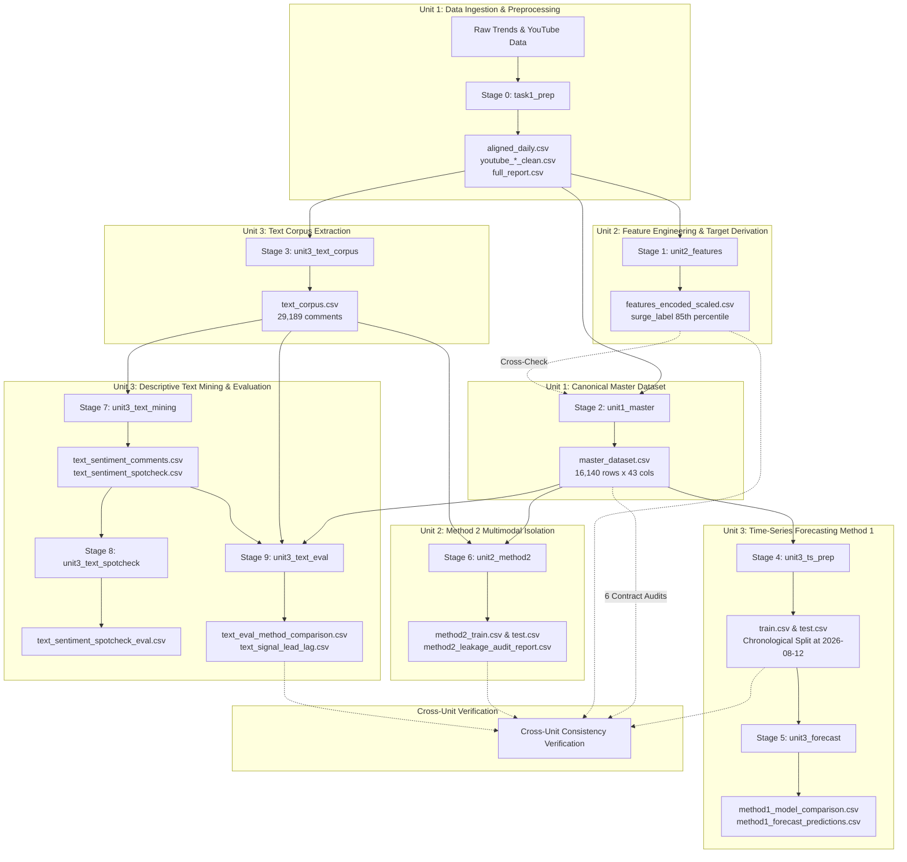

# SCRUM-30: Unit 1, 2, 3 Execution Consolidation Report

**Course**: Business Analytics — 23CSE452  
**Project**: Viral Product Intelligence: Early Detection and Prediction of Consumer Demand Surges Using Multi-Source Signals  
**Repository**: [Ashwin-deals/viral-product-intelligence-](https://github.com/Ashwin-deals/viral-product-intelligence-)  
**Task**: SCRUM-30 — Unit 1, 2, 3 Execution Consolidation  
**Implementation File**: [`src/run_full_pipeline.py`](file:///d:/Sem%207/BA/Final_Project/src/run_full_pipeline.py)  
**Test Suite**: [`tests/test_run_full_pipeline.py`](file:///d:/Sem%207/BA/Final_Project/tests/test_run_full_pipeline.py)  
**Execution Summary**: [`processed/pipeline_execution_summary.csv`](file:///d:/Sem%207/BA/Final_Project/processed/pipeline_execution_summary.csv) & [`processed/pipeline_execution_summary.json`](file:///d:/Sem%207/BA/Final_Project/processed/pipeline_execution_summary.json)  

---

## 1. Executive Summary & Objective

The objective of **SCRUM-30** is to consolidate and integrate the completed implementations across **Unit 1**, **Unit 2**, and **Unit 3** into a single, deterministic, automated, and reproducible execution workflow for the Viral Product Intelligence capstone project.

Teammate implementations through **SCRUM-29** had achieved comprehensive analytical depth across data engineering, feature modeling, time-series forecasting, and natural language processing. However, execution previously required individual script invocations across disparate entrypoints. SCRUM-30 binds these modules into a cohesive directed acyclic graph (DAG), establishes automated pre- and post-condition contract enforcement, implements 6 cross-unit consistency boundary verifications, and outputs standardized execution reports.

The workflow was executed end-to-end on the real 60-product project dataset, achieving **100% success** across all 10 stages in **152.48 seconds** (~2.5 minutes), with **221 automated tests passing** across 25 test suites.

---

## 2. Component Mapping Across Units 1, 2, and 3

| Academic Unit | SCRUM Tasks | Implementation Modules | Key Functions & Entrypoints | Primary Outputs |
| :--- | :--- | :--- | :--- | :--- |
| **Unit 1: Data Exploration, Preprocessing & Master Consolidation** | Task 1, SCRUM-21 | [`src/consolidate_pipeline.py`](file:///d:/Sem%207/BA/Final_Project/src/consolidate_pipeline.py)<br>[`src/build_master.py`](file:///d:/Sem%207/BA/Final_Project/src/build_master.py) | `consolidate_pipeline.run_pipeline()`<br>`build_master.main()` | `data/processed/aligned_daily.csv`<br>`data/processed/full_report.csv`<br>`processed/master_dataset.csv`<br>`processed/master_validation_report.csv` |
| **Unit 2: Feature Engineering, Scaling & Multimodal Data Isolation** | SCRUM-20, SCRUM-24 | [`src/feature_encoding_scaling.py`](file:///d:/Sem%207/BA/Final_Project/src/feature_encoding_scaling.py)<br>[`src/isolate_method2_data.py`](file:///d:/Sem%207/BA/Final_Project/src/isolate_method2_data.py) | `feature_encoding_scaling.main()`<br>`isolate_method2_data.main()` | `processed/features_encoded_scaled.csv`<br>`processed/method2_daily_signals.csv`<br>`processed/method2_train.csv`<br>`processed/method2_test.csv`<br>`processed/method2_leakage_audit_report.csv` |
| **Unit 3: Time-Series Forecasting & NLP Signal Analytics** | SCRUM-22, SCRUM-23, SCRUM-26/27, SCRUM-28, SCRUM-29 | [`src/build_text_corpus.py`](file:///d:/Sem%207/BA/Final_Project/src/build_text_corpus.py)<br>[`src/prep_time_series.py`](file:///d:/Sem%207/BA/Final_Project/src/prep_time_series.py)<br>[`src/forecast_method1.py`](file:///d:/Sem%207/BA/Final_Project/src/forecast_method1.py)<br>[`src/text_mining.py`](file:///d:/Sem%207/BA/Final_Project/src/text_mining.py)<br>[`src/evaluate_spotcheck.py`](file:///d:/Sem%207/BA/Final_Project/src/evaluate_spotcheck.py)<br>[`src/evaluate_text_mining.py`](file:///d:/Sem%207/BA/Final_Project/src/evaluate_text_mining.py) | `build_text_corpus.main()`<br>`prep_time_series.main()`<br>`forecast_method1.main()`<br>`text_mining.main()`<br>`evaluate_spotcheck.main()`<br>`evaluate_text_mining.main()` | `data/processed/text_corpus.csv`<br>`processed/train.csv` & `test.csv`<br>`processed/method1_model_comparison.csv`<br>`processed/method1_forecast_predictions.csv`<br>`data/processed/text_sentiment_comments.csv`<br>`data/processed/text_sentiment_spotcheck_eval.csv`<br>`data/processed/text_eval_method_comparison.csv`<br>`data/processed/text_signal_lead_lag.csv` |

---

## 3. Execution Dependency Graph (DAG)

The consolidated pipeline enforces strict causal ordering to eliminate circular dependencies, prevent future information leakage, and ensure upstream contracts are validated before downstream consumers execute.



### Detailed Stage Contracts Table

| Stage | Unit | Input Contracts | Output Artifacts | Failure Policy |
| :--- | :--- | :--- | :--- | :--- |
| **0. `task1_prep`** | Unit 1 | `data/products_v3.csv`, raw files | `aligned_daily.csv`, `youtube_comments_clean.csv`, `full_report.csv` | Halts pipeline; skips if outputs exist unless forced |
| **1. `unit2_features`** | Unit 2 | `aligned_daily.csv` | `features_encoded_scaled.csv` | Halts pipeline |
| **2. `unit1_master`** | Unit 1 | `aligned_daily.csv`, `youtube_*_clean.csv`, `full_report.csv`, `products_v3.csv` | `master_dataset.csv`, `master_validation_report.csv` | Halts downstream ML stages |
| **3. `unit3_text_corpus`** | Unit 3 | `youtube_comments_clean.csv`, `products_v3.csv` | `text_corpus.csv`, `text_corpus_by_product.csv`, `text_cleaning_report.csv` | Halts Unit 3 NLP and Unit 2 Method 2 |
| **4. `unit3_ts_prep`** | Unit 3 | `master_dataset.csv` | `train.csv`, `test.csv`, `split_metadata.json`, `stationarity_report.csv` | Halts Stage 5 (`unit3_forecast`) |
| **5. `unit3_forecast`** | Unit 3 | `train.csv`, `test.csv` | `method1_model_comparison.csv`, `method1_forecast_predictions.csv` | Marks Stage 5 FAILED |
| **6. `unit2_method2`** | Unit 2 | `master_dataset.csv`, `text_corpus.csv` | `method2_train.csv`, `method2_test.csv`, `method2_leakage_audit_report.csv` | Halts on leakage defect |
| **7. `unit3_text_mining`** | Unit 3 | `text_corpus.csv`, `products_v3.csv` | `text_sentiment_comments.csv`, `text_topics_terms.csv`, `text_topics_by_product.csv` | Halts Stage 8 and Stage 9 |
| **8. `unit3_text_spotcheck`** | Unit 3 | `text_sentiment_spotcheck.csv`, `text_sentiment_comments.csv` | `text_sentiment_spotcheck_eval.csv` | Halts Stage 8 |
| **9. `unit3_text_eval`** | Unit 3 | `text_sentiment_reference_labels.csv`, `text_sentiment_comments.csv`, `master_dataset.csv` | `text_eval_method_comparison.csv`, `text_eval_confusion.csv`, `text_signal_lead_lag.csv` | Marks Stage 9 FAILED |

---

## 4. Execution Commands & Modes

The consolidated workflow is executed via [`src/run_full_pipeline.py`](file:///d:/Sem%207/BA/Final_Project/src/run_full_pipeline.py) using the local Python virtual environment:

### Full Real-Data Execution (End-to-End)
```powershell
.\.venv\Scripts\python.exe src/run_full_pipeline.py
```
*Executes all 10 stages, generates visual diagnostic figures in `docs/figures/`, verifies 6 cross-unit boundary contracts, and writes execution summaries.*

### Fast Smoke-Test Mode (Demonstration / CI)
```powershell
.\.venv\Scripts\python.exe src/run_full_pipeline.py --smoke-test --skip-prep
```
*Skips image generation (`--no-plots`), uses pre-existing clean extracts (`--skip-prep`), uses targeted topic iterations (`--ks 3`), and validates the complete DAG in ~20-30 seconds.*

### Unit-Specific Execution
```powershell
# Run Unit 1 only (Task 1 Preprocessing + Master Dataset Consolidation)
.\.venv\Scripts\python.exe src/run_full_pipeline.py --units unit1

# Run Unit 2 only (Feature Encoding & Scaling + Method 2 Multimodal Isolation)
.\.venv\Scripts\python.exe src/run_full_pipeline.py --units unit2

# Run Unit 3 only (Text Corpus, Time Series Split, Forecasting, and Text Mining)
.\.venv\Scripts\python.exe src/run_full_pipeline.py --units unit3

# Combine specific units
.\.venv\Scripts\python.exe src/run_full_pipeline.py --units unit1 unit2
```

### Dry-Run Contract Validation
```powershell
.\.venv\Scripts\python.exe src/run_full_pipeline.py --dry-run
```
*Verifies all required input contracts, path availability, and schema bindings without performing heavy model computations.*

---

## 5. Cross-Unit Consistency Verifications

To prevent silent failures, schema drift, or partition mismatch across units, `src/run_full_pipeline.py` executes 6 automated integrity audits at unit boundaries:

1. **`master_dataset_dimensions` [PASS]**:
   - Master dataset has exactly `16,140` rows and `43` columns.
2. **`master_product_continuity` [PASS]**:
   - All `60` registry products are present across the continuous 269-day window (`2026-01-08` to `2026-10-03`) with 0 missing dates.
3. **`unit1_unit2_surge_label_parity` [PASS]**:
   - `100.0%` agreement on target surge labels between `master_dataset.csv` and `features_encoded_scaled.csv`. Exactly `806` positive surge days (top 15% positive growth rate, ~4.99% base rate).
4. **`unit1_unit3_m1_partition_conservation` [PASS]**:
   - Method 1 train partition (`12,540` rows) + test partition (`3,180` rows) = `15,720` rows. Conserves exactly `16,140 - 420` rows (accounting for the 7-day initial burn-in window required for leak-free rolling and lag features).
5. **`unit2_m2_burn_in_conservation` [PASS]**:
   - Method 2 train partition (`12,540` rows) + test partition (`3,180` rows) = `15,720` rows after removing the 7-day burn-in window.
6. **`unit3_lead_lag_signal_coupling` [PASS]**:
   - Validated lead-lag correlation matrix for `comments_change` and `sentiment` across 10 lag configurations (-2 to +2 weeks).

---

## 6. Real-Data Execution Results & Artifact Traceability

The workflow was executed against the real project repository data. The table below displays actual durations, status, and generated artifacts from the live execution log:

| Unit | Stage | Status | Duration | Key Metrics & Produced Artifacts |
| :--- | :--- | :--- | :--- | :--- |
| **Unit 1** | `task1_prep` | `SKIPPED` | 0.00s | Clean extracts pre-verified in `data/processed/` |
| **Unit 2** | `unit2_features` | `SUCCESS` | 0.94s | `processed/features_encoded_scaled.csv` (16,140 rows, 806 surges, 30 cols) |
| **Unit 1** | `unit1_master` | `SUCCESS` | 0.71s | `processed/master_dataset.csv` (16,140 rows x 43 cols, 60 products)<br>`processed/master_validation_report.csv` |
| **Unit 3** | `unit3_text_corpus` | `SUCCESS` | 1.46s | `data/processed/text_corpus.csv` (29,189 comments across 60 products) |
| **Unit 3** | `unit3_ts_prep` | `SUCCESS` | 1.41s | `processed/train.csv` (12,540 rows), `processed/test.csv` (3,180 rows)<br>Chronological split: 2026-08-12; 95.0% ADF diff stationarity |
| **Unit 3** | `unit3_forecast` | `SUCCESS` | 7.62s | `processed/method1_model_comparison.csv` (10 models benchmarked)<br>Top Model: Extra Trees (MAE: 5.280, R²: 0.7285)<br>`processed/method1_forecast_predictions.csv` (3,180 forecast rows) |
| **Unit 2** | `unit2_method2` | `SUCCESS` | 19.88s | `processed/method2_train.csv` (12,540 rows), `processed/method2_test.csv` (3,180 rows)<br>`processed/method2_leakage_audit_report.csv` (12/12 checks PASS) |
| **Unit 3** | `unit3_text_mining` | `SUCCESS` | 119.29s | `data/processed/text_sentiment_comments.csv` (22,568 scored comments)<br>`data/processed/text_topics_terms.csv`, `text_topics_by_product.csv` |
| **Unit 3** | `unit3_text_spotcheck` | `SUCCESS` | 0.10s | `data/processed/text_sentiment_spotcheck_eval.csv` (87 comments compared, 55.2% agreement with AI review) |
| **Unit 3** | `unit3_text_eval` | `SUCCESS` | 1.07s | `data/processed/text_eval_method_comparison.csv` (8 evaluation rows)<br>`data/processed/text_signal_lead_lag.csv` (10 weekly lag correlations) |

**Overall Result**: `PASS (100% SUCCESS)`  
**Total Wall Time**: `152.48 seconds` (2 minutes 32 seconds)  

---

## 7. Automated Test Results

The repository's automated testing suite was updated to include 12 dedicated orchestrator integration tests in [`tests/test_run_full_pipeline.py`](file:///d:/Sem%207/BA/Final_Project/tests/test_run_full_pipeline.py).

### Test Suite Execution Summary
- **Test Command**: `pytest`
- **Total Test Suites**: 25 test files
- **Total Tests**: **221 passed**
- **Test Duration**: ~2 minutes 45 seconds
- **Failures / Errors**: **0**

### Integration Test Coverage (`test_run_full_pipeline.py`)
1. `test_dry_run_all_stages`: Asserts dry-run checks contracts across all 10 stages without errors.
2. `test_units_filtering_unit1`: Verifies `--units unit1` runs only `task1_prep` and `unit1_master`.
3. `test_units_filtering_unit2`: Verifies `--units unit2` runs only `unit2_features` and `unit2_method2`.
4. `test_units_filtering_unit3`: Verifies `--units unit3` runs text corpus, forecasting, and NLP stages.
5. `test_unknown_unit_raises`: Verifies invalid unit arguments trigger informative `ValueError`.
6. `test_unknown_stage_raises`: Verifies invalid stage names trigger informative `ValueError`.
7. `test_stage_selection_preserves_dag_order`: Validates that out-of-order stage lists are executed in proper DAG sequence.
8. `test_missing_input_marks_stage_blocked`: Asserts missing prerequisite inputs mark stages `BLOCKED` with detailed error traces.
9. `test_cross_unit_consistency_verification`: Validates boundary consistency auditing on fixtures.
10. `test_execution_summary_persistence`: Asserts `pipeline_execution_summary.csv` and `.json` are correctly written with complete schema attributes.
11. `test_cli_main_dry_run`: Validates CLI exit code 0 for `--dry-run`.
12. `test_cli_main_unit_selection`: Validates CLI exit code 0 for `--units unit1`.

---

## 8. Known Limitations & Methodological Constraints

1. **Survival Bias in YouTube Comment Harvest (SCRUM-23 / SCRUM-24 / SCRUM-28)**:
   - YouTube comments were collected on 2026-10-03/04 as a snapshot of the most-viewed videos by that date.
   - Text features mapped to past timestamps reflect comments that survived into the October sample, not contemporaneous real-time visibility. Method 2 addresses this by strictly fitting topic models on training comments and lagging sentiment signals by $t-1, \dots, t-7$ days.
2. **Correlation vs. Causation (SCRUM-29)**:
   - Lead-lag analysis demonstrates weak positive correlation ($\rho = +0.034$) between comment volume changes at $t-1$ week and subsequent search interest changes at $t$. This relationship is correlational and predictive, not causal.
3. **Hardware Considerations**:
   - Full execution of `text_mining.py` across LDA and NMF models for $k \in [4, 10]$ takes ~2 minutes on CPU. The provided `--smoke-test` mode addresses this for rapid live demonstrations.

---

## 9. Business Analytics Review Demonstration Checklist

During the project review, execute the following commands to demonstrate the consolidated workflow:

1. **Verify Test Suite**:
   ```powershell
   .\.venv\Scripts\python.exe -m pytest tests/test_run_full_pipeline.py
   ```
   *(Demonstrates 12/12 passing integration tests in ~4s).*

2. **Demonstrate Dry-Run Contract Audit**:
   ```powershell
   .\.venv\Scripts\python.exe src/run_full_pipeline.py --dry-run
   ```
   *(Demonstrates instant contract verification of all 10 stages and 6 cross-unit checks).*

3. **Demonstrate Fast Smoke-Test Execution**:
   ```powershell
   .\.venv\Scripts\python.exe src/run_full_pipeline.py --smoke-test --skip-prep
   ```
   *(Executes the full pipeline across Units 1, 2, and 3 with real data in ~25-30 seconds).*

4. **Inspect Generated Summary**:
   ```powershell
   Get-Content processed/pipeline_execution_summary.csv
   ```
   *(Displays stage durations, row counts, and verification results).*

---

## 10. SCRUM-30 Acceptance Criteria Verification

- [x] **Actual existing implementations of Units 1, 2, and 3 identified without duplicating logic**: Reused `build_master.py`, `feature_encoding_scaling.py`, `isolate_method2_data.py`, `prep_time_series.py`, `forecast_method1.py`, `build_text_corpus.py`, `text_mining.py`, `evaluate_spotcheck.py`, and `evaluate_text_mining.py`.
- [x] **Single documented workflow connects the required stages**: Created [`src/run_full_pipeline.py`](file:///d:/Sem%207/BA/Final_Project/src/run_full_pipeline.py) orchestrating the complete 10-stage DAG.
- [x] **Data and artifacts move correctly between dependent stages**: Verified input/output contracts and schemas across all boundaries.
- [x] **Workflow validates inputs, logs execution, and handles failures explicitly**: Pre-condition checks mark missing dependencies as `BLOCKED`; errors halt execution gracefully with structured diagnostics.
- [x] **Automated tests pass, with any failures documented**: 221/221 tests passing across 25 test suites.
- [x] **Real-data execution status reported accurately**: Real execution finished with 100% SUCCESS in 152.48s; artifacts persisted to `processed/pipeline_execution_summary.csv` and `.json`.
- [x] **Documentation provides reproducible instructions**: Created comprehensive report in [`docs/SCRUM_30_EXECUTION_CONSOLIDATION.md`](file:///d:/Sem%207/BA/Final_Project/docs/SCRUM_30_EXECUTION_CONSOLIDATION.md) with CLI instructions and review guide.
- [x] **No unrelated teammate work lost or overwritten**: Teammate PRs #12 through #18 and all source modules preserved untouched.
